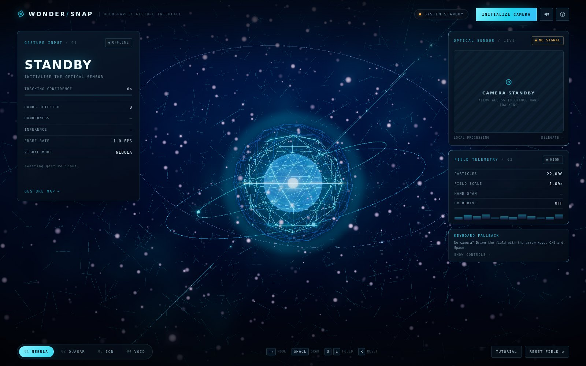

# WONDER/SNAP — JARVIS Gesture Interface

A real-time, gesture-controlled holographic scene that runs entirely in the browser.
Your webcam feed is read by MediaPipe's Hand Landmarker (21 landmarks per hand, on-device),
filtered with a One-Euro filter, classified into gestures, and mapped onto a live Three.js
"energy field" wrapped in a JARVIS-style HUD.

No server, no upload, no simulated input: every frame of movement comes from a real camera.



---

## Table of contents

1. [What it does](#what-it-does)
2. [Features](#features)
3. [Tech stack](#tech-stack)
4. [Requirements](#requirements)
5. [Install and run](#install-and-run)
6. [Project structure](#project-structure)
7. [How it works](#how-it-works)
8. [Testing every gesture](#testing-every-gesture)
9. [Automated tests](#automated-tests)
10. [Performance and quality tiers](#performance-and-quality-tiers)
11. [Honest limitations](#honest-limitations)
12. [Troubleshooting](#troubleshooting)
13. [Privacy](#privacy)
14. [License](#license)

---

## What it does

Raise a hand to the camera and the scene reacts:

| Gesture | Detected as | 3D effect |
| --- | --- | --- |
| Open palm (5 fingers up) | `OPEN_PALM` (continuous) | Expands the particle field, pushes the camera back, widens the orbital rings |
| Closed fist | `FIST` (continuous) | Compresses the universe into a dense sphere, tightens the field |
| Thumb + index pinch | `PINCH` (discrete, hysteresis) | Grabs the central hologram — it follows your hand, spins with your wrist, releases with a shockwave |
| Two fingers held together | `PEACE` (discrete) | Fires a crackling energy arc between your fingertips |
| Two fingers in a V | `VICTORY` (discrete) | 8 seconds of overdrive: brighter field, faster motion, violet storm |
| Thumbs up | `THUMB_UP` (discrete) | Confirm pulse + confirmation chime |
| Swipe left / right (open hand) | `SWIPE_LEFT` / `SWIPE_RIGHT` (discrete) | Previous / next visual mode |
| Both hands visible | `TWO_HANDS` (continuous) | Links both hands with an energy beam; hand span scales the whole field |
| Both hands pulled apart / pushed together | `SPREAD` / `CLOSE` (discrete) | Expands / collapses the universe |

Hand position also steers the entire field (the scene follows your hand around the frame),
and hand rotation spins the hologram while it is grabbed.

## Features

**Hand tracking**
- MediaPipe Hand Landmarker, 2 hands, 21 landmarks each, running locally through WebAssembly + WebGL.
- Model file and WASM runtime are served from this repo — no CDN round-trip at runtime.
- One-Euro filtering per landmark (jitter removed without adding visible lag).
- Nearest-palm identity association, so two hands keep independent state even when MediaPipe
  reports the same handedness for both (`Right` / `Right-2`).
- Landmark overlay drawn directly on the camera preview.

**Gesture engine**
- Frame-rate independent: every smoothing channel uses exponential damping with a `dt` clamp,
  so the same gesture feels identical at 30 fps or 120 fps.
- 4-frame stability gate + 0.55 mean-confidence gate before a gesture is accepted (no flicker).
- Per-gesture cooldowns, and pinch hysteresis so a fist can never fake a grab.
- Only the two continuous shaping poses (open palm / fist) drive expansion and compression —
  discrete poses (thumbs up, victory…) never collapse the field as a side effect.
- Swipe detection with distance, speed and time-window thresholds.

**3D visuals (Three.js)**
- 7k–22k GPU particles, link lines, starfield backdrop, orbital rings, Fresnel hologram core,
  procedural lightning bolts, shockwaves, grab trails, bloom post-processing.
- Four visual modes (NEBULA / QUASAR / ION / VOID), each with its own palette, energy and icon.
- Everything is procedural — no textures, no models, no image assets to download.

**HUD**
- Live telemetry: tracking confidence, hands detected, handedness, inference time, frame rate,
  visual mode, particle count, field scale, hand span, overdrive timer.
- Four-step tutorial, full gesture map drawer, event log, toasts.
- Keyboard fallback documented in-app, so the experience is fully usable without a camera.

**Interaction and usability**
- Every control is a real button: start/stop camera, sound, mode select, tutorial, reset, help.
- Keyboard operable end to end, with `Esc` closing every overlay.
- Camera failures are explained in plain language (permission blocked, no camera, camera busy…)
  with a RETRY button and automatic fallback to keyboard control.
- Responsive from 320 px phones to 4K desktops; landscape phones get a two-column layout.
- Synthesised audio (Web Audio API, no audio files) with a persistent mute toggle.
- Automatic quality downshift if the frame rate stays below 34 fps.

## Tech stack

| Layer | Choice |
| --- | --- |
| Bundler / dev server | Vite 6 (native ES modules, no framework) |
| 3D | Three.js 0.180 (WebGL2) |
| Hand tracking | `@mediapipe/tasks-vision` 0.10.14 — Hand Landmarker (float16, GPU delegate, CPU fallback) |
| Language | Modern JavaScript (ES2022 modules), no TypeScript, no transpile step in dev |
| UI | Hand-written HTML/CSS (custom properties, grid/flex), vanilla DOM modules |
| Audio | Web Audio API synthesis |
| Tests | `node:test` (unit) + `puppeteer-core` (headless browser smoke test) |

Runtime dependencies: **two** (`three`, `@mediapipe/tasks-vision`). Build dependency: **one** (`vite`).

## Requirements

- **Node.js 18+** (tested on Node 22) and npm 9+.
- **A camera** and a browser with WebGL2 + WebAssembly: Chrome/Edge 100+, Firefox 113+, Safari 16.4+.
  (Development was verified in Chromium; see [limitations](#honest-limitations).)
- A **secure context**: `http://localhost` is fine, any other host needs HTTPS. Browsers block
  `getUserMedia` on plain `http://192.168.x.x`.
- First run downloads npm packages (~90 MB incl. the MediaPipe WASM runtime).

## Install and run

```bash
# 1. clone and enter the project
git clone https://github.com/<your-user>/wondersnap-jarvis.git
cd wondersnap-jarvis

# 2. install dependencies (postinstall also stages the WASM runtime into public/wasm)
npm install

# 3. start the dev server
npm run dev
```

Open the URL Vite prints — by default **http://localhost:5173** — then press
**INITIALIZE CAMERA** and allow camera access.

Production build:

```bash
npm run build     # outputs static files to dist/
npm run preview   # serves dist/ at http://localhost:4173
```

`dist/` is a fully static site: copy it to any HTTPS host (Netlify, Vercel, GitHub Pages, nginx).

### Package scripts

| Command | What it does |
| --- | --- |
| `npm install` | Installs dependencies, then copies the MediaPipe WASM runtime to `public/wasm` and checks for the hand model |
| `npm run dev` | Asset setup + Vite dev server with HMR on `0.0.0.0:5173` |
| `npm run build` | Asset setup + production build into `dist/` |
| `npm run preview` | Serves the built `dist/` on `0.0.0.0:4173` |
| `npm run assets` | Re-runs the asset staging step (safe, idempotent) |
| `npm test` | 18 unit tests for the gesture engine (Node's built-in test runner) |
| `npm run test:browser` | Headless-Chromium smoke test of the real UI (needs Chrome, see below) |
| `npm run test:all` | Unit tests + browser tests |

### The hand model

`public/models/hand_landmarker.task` (7.8 MB) is committed so the app works offline out of the box.
If it is ever missing, `npm run assets` tries to download it from the MediaPipe CDN; you can also
drop the file in by hand:

```bash
curl -L -o public/models/hand_landmarker.task \
  https://storage.googleapis.com/mediapipe-models/hand_landmarker/hand_landmarker/float16/1/hand_landmarker.task
```

## Project structure

```
wondersnap-jarvis/
├── index.html                  # single-page shell: HUD markup, overlays, canvas, video
├── package.json
├── vite.config.js
├── docs/screenshots/           # README images
├── public/
│   ├── models/hand_landmarker.task     # MediaPipe hand model (float16)
│   └── wasm/                           # MediaPipe WASM runtime (generated by npm install)
├── scripts/
│   └── setup-assets.mjs        # copies WASM out of node_modules, verifies the model
├── src/
│   ├── main.js                 # App: bootstrap, main loop, gesture → scene wiring, HUD updates
│   ├── config.js               # every tunable: gestures, thresholds, modes, keyboard help
│   ├── tracking/
│   │   ├── HandTracker.js      # camera + MediaPipe task + model/wasm loading + errors
│   │   ├── GestureEngine.js    # landmark → gesture classification, stability, cooldowns
│   │   ├── OneEuroFilter.js    # landmark smoothing
│   │   ├── Smoothing.js        # exponential damping helpers
│   │   └── geometry.js         # vector math, angle/distance helpers, clamp
│   ├── scene/
│   │   ├── SceneManager.js     # renderer, camera, resize, quality, screen→world mapping
│   │   ├── Visualizer.js       # maps gesture channels onto every 3D subsystem
│   │   ├── ParticleField.js    # GPU particle "universe" shader
│   │   ├── Hologram.js         # Fresnel core, nucleus, wireframe shells, rings
│   │   ├── OrbitalRings.js     # orbit rings
│   │   ├── LinkLines.js        # particle-to-particle links + hand links
│   │   ├── Backdrop.js         # starfield + nebula
│   │   ├── Effects.js          # lightning, shockwaves, grab trails, reticles
│   │   └── PostFX.js           # bloom composer (guarded fallback)
│   ├── input/KeyboardController.js
│   ├── ui/{Hud,Tutorial,Reference}.js
│   ├── audio/AudioEngine.js
│   └── styles/{index,base,hud,overlays,responsive}.css
└── tests/
    ├── unit/gesture-engine.test.mjs    # 18 tests against real captured landmarks
    ├── fixtures/*.json                 # real landmark captures: palm, fist, thumb, OK, peace
    └── browser/run.mjs                 # headless smoke test of the live UI
```

## How it works

```
webcam ─► getUserMedia ─► HandLandmarker (GPU delegate)
                              │ 21 landmarks × up to 2 hands
                              ▼
                     One-Euro filter (per hand, per landmark)
                              ▼
        ┌───────────── GestureEngine ─────────────┐
        │ continuous: open palm, fist, span       │
        │ discrete:   pinch, peace, victory,      │
        │             thumbs up, swipes, spread   │
        └──────────────────┬──────────────────────┘
                           ▼
              exponential-damped channels
        (expand, compress, grab, steer x/y, span)
                           ▼
        Visualizer ─► shader uniforms / object transforms
                           ▼
             Three.js scene + bloom + HUD
```

- **Frame-rate independence.** Damping uses `1 - Math.exp(-rate * dt)` with `dt` clamped to
  `[0.0005, 0.2] s`, and the HUD shows a true 500 ms rolling-average FPS, so the interface behaves
  the same on a 144 Hz monitor and on a struggling laptop.
- **Identity.** When two hands share a handedness label, they are disambiguated by nearest-palm
  association to the previous frame, so each hand keeps its own filter and gesture state.
- **Grab semantics.** `PINCH_START` fires only from an accepted, stable pinch — a fist, an open
  palm or a partially closed hand cannot grab the hologram.

## Testing every gesture

Everything below was exercised against the running app. Gestures are read from the **GESTURE INPUT**
panel (top-left): it shows the recognised gesture, its confidence, hands detected, handedness,
inference time and the event log.

> ### Suggested setup
> 1. `npm run dev`, open `http://localhost:5173` in Chrome.
> 2. Sit ~60–80 cm from the camera, plain background, light **in front of** you (not behind).
> 3. Press **INITIALIZE CAMERA** → allow access. The chip goes `LIVE` and the readout leaves `STANDBY`.
> 4. Keep the whole hand inside the frame, palm facing the lens.
> 5. Open **GESTURE MAP →** (or press `H`) to keep the reference table on screen.

### One hand — continuous

| Step | Do this | Expect |
| --- | --- | --- |
| 1. Open palm | Hold all five fingers open, steady for ~0.5 s | Readout: `OPEN PALM`; confidence > 90 %; field expands, camera pulls back, HUD field scale rises above 1.0; event log `OPEN PALM → EXPAND UNIVERSE` |
| 2. Closed fist | Close the hand tightly for ~0.5 s | Readout: `CLOSED FIST`; particles collapse toward the centre, field scale drops below 1.0, rings contract |
| 3. Pinch / OK sign | Touch thumb + index tips together, hold ~0.4 s | Readout: `PINCH`; hologram turns grabbed (grab channel > 0.5), it follows your hand; open the fingers → shockwave ring + log `PINCH RELEASED → SHOCKWAVE` |
| 4. Two fingers together | Index + middle up, pressed together | Readout: `TWO FINGER`; lightning arc appears between the fingertips and follows them |
| 5. Victory (V) | Index + middle up, spread apart | Readout: `VICTORY`; `VICTORY → OVERDRIVE ENGAGED`, overdrive timer counts down from 8 s, field gets brighter/faster |
| 6. Thumbs up | Fist with the thumb pointing up | Readout: `THUMB UP`; confirm pulse, log `THUMB UP → SIGNAL CONFIRMED` |
| 7. Swipe | Open palm, sweep left→right (or right→left) quickly across the frame | Readout: `SWIPE RIGHT` / `SWIPE LEFT`; mode switches to the next/previous palette; log `VISUAL MODE → …` |

### Two hands — with the second hand in frame

| Step | Do this | Expect |
| --- | --- | --- |
| 8. Both hands visible | Raise both hands, palms toward the camera | HUD hands detected = `2`, handedness lists two ids (`Right`, `Right-2`), readout `DUAL HAND`, a beam links the hands |
| 9. Hands apart | Slowly pull both hands outward | Readout `HANDS APART`; field expands continuously; hand span number grows |
| 10. Hands together | Bring both palms toward each other | Readout `HANDS TOGETHER`; field collapses toward the centre |
| 11. Pinch with one hand while the other stays visible | Pinch with the right hand | Only the pinching hand grabs; the other hand keeps steering — no double grab |

### Keyboard equivalents (no camera needed)

Every gesture has a keyboard twin, so the whole app is verifiable without a webcam — and this is
the fastest way to confirm the *scene* side of each mapping:

| Key | Action |
| --- | --- |
| Arrow keys / `W A S D` | Steer the field |
| `Q` / `E` *(hold)* | Expand / compress (open palm / fist) |
| `Space` *(hold)* | Grab the hologram (pinch) |
| `V` | Energy arc (two fingers) |
| `X` | Overdrive (victory) |
| `Y` | Confirm (thumbs up) |
| `1`–`4` | Select visual mode |
| `[` / `]` | Previous / next mode (swipes) |
| `C` | Start / stop camera |
| `M` | Mute / unmute |
| `R` | Reset the experience |
| `H` | Gesture map |
| `T` | Replay the tutorial |
| `Esc` | Close any overlay |

### Did I actually test this?

Yes — with a caveat that is stated plainly: the development environment has **no physical webcam**,
so gestures were verified by feeding **real captured video of a real hand** into Chromium's camera
device (`--use-file-for-fake-video-capture`), which exercises the exact same `getUserMedia` →
MediaPipe → gesture → scene path as a live webcam. Recorded results:

| Input clip | Result in the HUD | Scene result |
| --- | --- | --- |
| Open palm | `OPEN PALM`, 99 % | expand channel 1.0, field scale 1.27–1.42 |
| Closed fist | `CLOSED FIST`, 100 % | compress channel 1.0, field scale 0.50–0.68 |
| Thumbs up | `THUMB UP`, 83 % | `THUMB UP → SIGNAL CONFIRMED` |
| OK / pinch | `PINCH`, 81 % | grab 0.58, hologram moves, `PINCH RELEASED → SHOCKWAVE` |
| Victory | `VICTORY` | `VICTORY → OVERDRIVE ENGAGED` |
| Two hands | 2 hands, ids `Right`/`Right-2` | `DUAL HAND`, span 0.5, no spurious grab |

Those clips ran at ~2 fps because the container has no GPU (software WebGL); on real hardware the
same code runs at 30–60 fps. What this does **not** replace: a final pass with your own camera in
your own lighting, which is exactly what the step-by-step recipe above is for.

## Automated tests

```bash
npm test                  # 18 unit tests, no browser needed
npm run test:browser      # headless UI smoke test (needs Chrome)
```

`npm test` runs the gesture engine against real landmark captures in `tests/fixtures/`:

- classification of open palm, fist, thumbs up, OK/pinch, peace vs victory
- stability gating, no-flicker on alternating poses, per-gesture cooldowns
- swipe distance/speed/window rejection, two-hand span and spread/close
- pinch hysteresis, paired start/release events, release when the hand leaves frame
- malformed input handling, two hands with the same handedness staying independent,
  discrete poses not leaking into the expand/compress channels

`npm run test:browser` starts Vite itself and drives the real page in headless Chromium:
boot, four visual modes, `Q`/`E` field response, `Space` grab + release, `V` arc and `X` overdrive,
gesture map open/close, sound toggle, reset, tutorial replay, no horizontal overflow at
1280/768/390 px, and a clean console.

```bash
# use a browser that is not in a standard location
CHROME_PATH=/usr/bin/chromium npm run test:browser

# point it at an already running dev server
BASE_URL=http://localhost:5173 npm run test:browser

# also check that the camera pipeline boots (uses the fake device, or your webcam)
FAKE_CAMERA=/path/to/clip.y4m npm run test:browser -- --camera
```

## Performance and quality tiers

| Tier | Particles | Links | Stars | Post-processing |
| --- | --- | --- | --- | --- |
| `low` | 7 000 | 500 | 1 200 | none |
| `medium` | 13 000 | 900 | 2 000 | bloom |
| `high` | 22 000 | 1 400 | 3 000 | bloom + higher pixel ratio |

The tier is auto-selected (mobile or ≤ 4 CPU cores → `medium`, otherwise `high`) and forced down one
step if the measured FPS stays below 34 for 4 seconds. Force a tier with the URL:

```
http://localhost:5173/?quality=low
http://localhost:5173/?quality=high
```

The HUD's FRAME RATE row reports a true 500 ms rolling average, so it is trustworthy when tuning.

## Honest limitations

- **No physical webcam in the verification environment.** Gestures were validated with recorded
  real-hand video pushed through the real camera API (see above), not with a live sensor on this
  machine. Expect small threshold differences on your own camera, lighting and skin tone.
- **Different lighting will change confidence.** Backlight, low light, motion blur, a hand too close
  to the lens or partly out of frame will drop the landmark confidence, and the gesture is then
  deliberately *not* fired (the engine prefers missing a gesture over a false one).
- **One browser engine verified.** Everything was tested in Chromium. Firefox and Safari should work
  (same APIs, MediaPipe falls back to the CPU delegate) but were not exercised here.
- **Responsive layout was verified by viewport emulation**, not on physical phones or tablets.
- **Two hands are tracked, not modelled.** When hands overlap or cross, MediaPipe can momentarily
  swap or lose one; the scene tolerates it, but a grab can drop for a frame or two.
- **Landmark-only tracking.** No finger joints beyond the 21 landmarks, no depth camera, no
  pinch-strength beyond thumb–index distance. The scene is 2.5D: your hand drives a plane, not a
  volumetric space.
- **Swipes are fast by design.** A slow drift across the frame is intentionally not a swipe.
- **No audio until you interact.** Browsers require a user gesture before audio can start, so the
  first click/keypress creates the audio context (the state persists via `localStorage`).
- **Not a multi-user or networked app** — one camera, one viewer, no backend, no persistence beyond
  tutorial/sound preferences.
- **The model is font/asset independent but not CDN independent**: the WASM runtime and model are
  served from your own origin, so the app works offline after install.

## Troubleshooting

| Symptom | Cause / fix |
| --- | --- |
| "Camera permission was blocked" | Click the camera icon in the address bar, allow, press **RETRY CAMERA** |
| "The camera is already in use by another app" | Close Zoom/Teams/OBS (or any tab using the camera) and retry |
| "No camera was found on this device" | The HUD stays fully usable: drive it with the keyboard |
| Camera never goes `LIVE` | Serve over `http://localhost` or HTTPS — plain HTTP on a LAN IP is blocked by browsers |
| Model fails to load | Check `public/models/hand_landmarker.task` exists (7.8 MB). Offline? Copy it manually and reload |
| WASM 404s | Run `npm run assets` (regenerates `public/wasm` from `node_modules`) |
| Low FPS | Append `?quality=low`, close other GPU-heavy tabs, or use a dedicated GPU browser profile |
| Gestures feel delayed | Sit closer to the light, hold poses ~0.3 s, keep the hand inside the frame |
| No sound | Press `M` / the speaker button once (browser autoplay policy) |

## Privacy

All processing happens in your browser. The video stream never leaves the device: there is no
upload, no WebSocket, no analytics and no third-party request at runtime — the model and WASM are
served from the same origin as the page.

## License

MIT — see [LICENSE](LICENSE). The MediaPipe hand model is distributed by Google under the
[MediaPipe model licence](https://github.com/google-ai-edge/mediapipe/blob/master/LICENSE).
